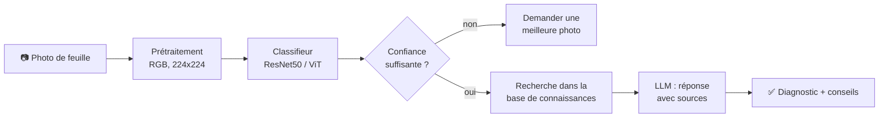

<div align="center">

# 🌿 Détection des maladies des plantes + assistant textuel

**Projet NLP & Computer Vision**


</div>

---

## 🎯 Objectif

Un système qui reçoit **une photo de feuille** et :
1. **Vision (CV)** : prédit la maladie de la plante.
2. **Texte (NLP, RAG)** : explique la maladie (symptômes, causes, traitement) à partir d'une base de connaissances, avec les sources.

Les deux parties sont reliées : la maladie prédite et la confiance du modèle décident de ce que l'assistant répond.

## 🧭 Pipeline



> 🟦 Vision : photo, prétraitement, classifieur  ·  🟩 Texte : recherche, LLM  ·  🟨 Les deux : décision selon la confiance

## 👥 Équipe

| Personne | Rôle | Contenu |
|---|---|---|
| **Personne 1** : [NOM] | 👁️ Vision (CV) | Données images, nettoyage, ResNet50 et ViT, Grad-CAM, test de généralisation |
| **Personne 2** : [NOM] | 💬 NLP (RAG) | Base de connaissances, embeddings, génération avec sources, questions de test |
| **Personne 3** : [NOM] | 🔗 Intégration | Pipeline, seuil de confiance, démo, évaluation de bout en bout, rapport |

## 📁 Contenu du dépôt

| Fichier | Description |
|---|---|
| `01_exploration_images.ipynb` | Étape 1 : exploration des images (classes, dimensions, doublons, correspondance des classes) |
| `02_classifieur_gradcam.ipynb` | Nettoyage, prétraitement, ResNet50 et ViT, généralisation, confiance, Grad-CAM, fonction `predict` |
| `classes.json` | Liste des 27 classes utilisées par le modèle |
| `resultats_generalisation.csv` | Résultats : PlantVillage (laboratoire) contre PlantDoc (terrain) |
| Modèle entraîné `modele_resnet50.pt` | [🔗 Lien Google Drive : à ajouter] |

## 🌱 Données

| Dataset | Type | Images | Classes | Licence |
|---|---|---|---|---|
| [PlantVillage](https://github.com/spMohanty/PlantVillage-Dataset) | Laboratoire, fond simple | 54 305 | 38 | CC0 1.0 |
| [PlantDoc](https://github.com/pratikkayal/PlantDoc-Dataset) | Terrain, fonds variés | 2 342 train + 236 test | 28 / 27 | CC BY 4.0 |

- **27 classes communes** aux deux bases (table de correspondance dans le notebook 2).
- **Nettoyage** (35 images enlevées) : 21 doublons dans PlantVillage, 11 images du test PlantDoc déjà présentes dans le train, 3 images dans PlantDoc train.
- Découpage par feuille d'origine pour éviter la fuite de données.

## 📊 Résultats (partie Vision)

Modèles entraînés sur **PlantVillage**, puis testés sur PlantVillage et sur **PlantDoc** (jamais vu).

| Modèle | PlantVillage test | PlantDoc test (225 images) | PlantDoc toutes (2 564 images) |
|---|---|---|---|
| ResNet50 | **97,9 %** | 31,1 % | 22,8 % |
| ViT-B/16 | **97,3 %** | 29,8 % | 22,2 % |

**Ce que montrent les résultats :**
- 🔻 La précision chute d'environ 70 points entre le laboratoire et le terrain.
- 🎲 Le hasard donnerait environ 3,7 % (27 classes) : les modèles font mieux, mais ne généralisent pas bien.
- ⚖️ Pas de différence claire entre ResNet50 et ViT.
- 🍃 Les feuilles saines (healthy) sont les plus difficiles sur PlantDoc.
- ⚠️ Beaucoup d'erreurs ont une confiance élevée. Un seuil seul ne suffit pas : risque de conseils précis mais faux dans le RAG (propagation des erreurs).

## 🔌 Contrat d'interface (Vision)

```python
predict(image)  # chemin ou image PIL
# renvoie :
{"top3": [("Tomato___Late_blight", 0.94), ("Tomato___Early_blight", 0.03), ("Potato___Late_blight", 0.01)]}
```

Les noms de classes sont dans `classes.json` (format PlantVillage). Une table de correspondance avec les noms de la base de connaissances reste à faire avec la Personne 2.


## 📚 Références (partie Vision)

- Hughes & Salathé (2015). *An open access repository of images on plant health to enable the development of mobile disease diagnostics.* arXiv:1511.08060
- Singh et al. (2020). *PlantDoc: A Dataset for Visual Plant Disease Detection.* CoDS-COMAD
- Mohanty et al. (2016). *Using Deep Learning for Image-Based Plant Disease Detection.* Frontiers in Plant Science
- Barbedo (2018). *Impact of dataset size and variety on the effectiveness of deep learning and transfer learning for plant disease classification.* Computers and Electronics in Agriculture
- He et al. (2016). *Deep Residual Learning for Image Recognition.* CVPR
- Dosovitskiy et al. (2021). *An Image is Worth 16x16 Words.* ICLR
- Selvaraju et al. (2017). *Grad-CAM.* ICCV
